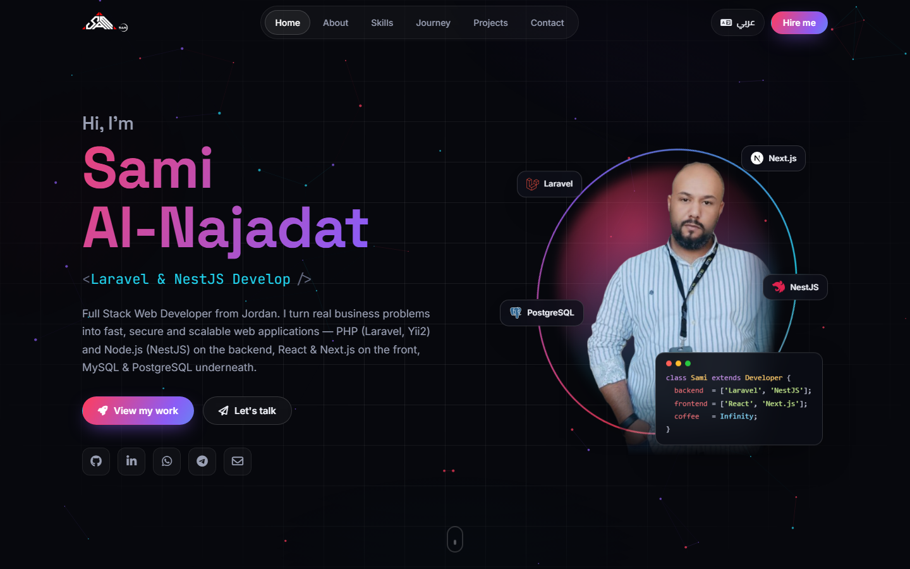
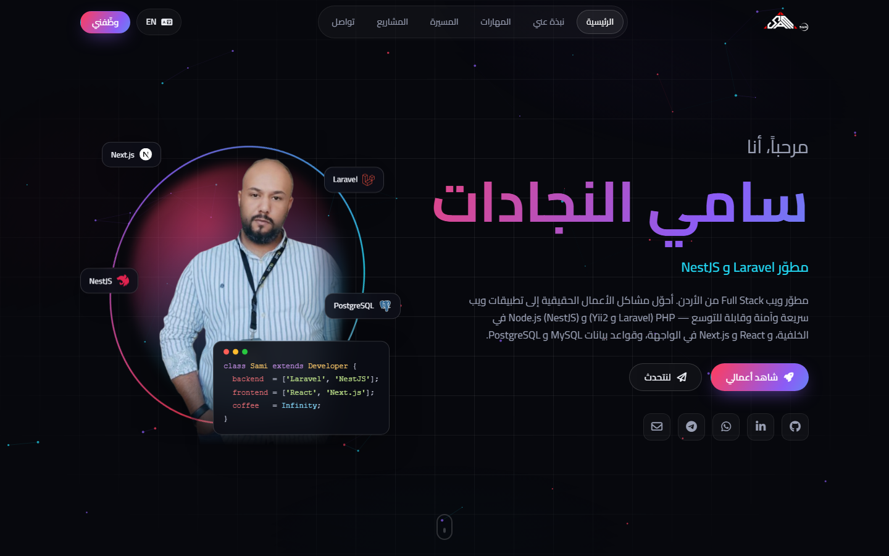
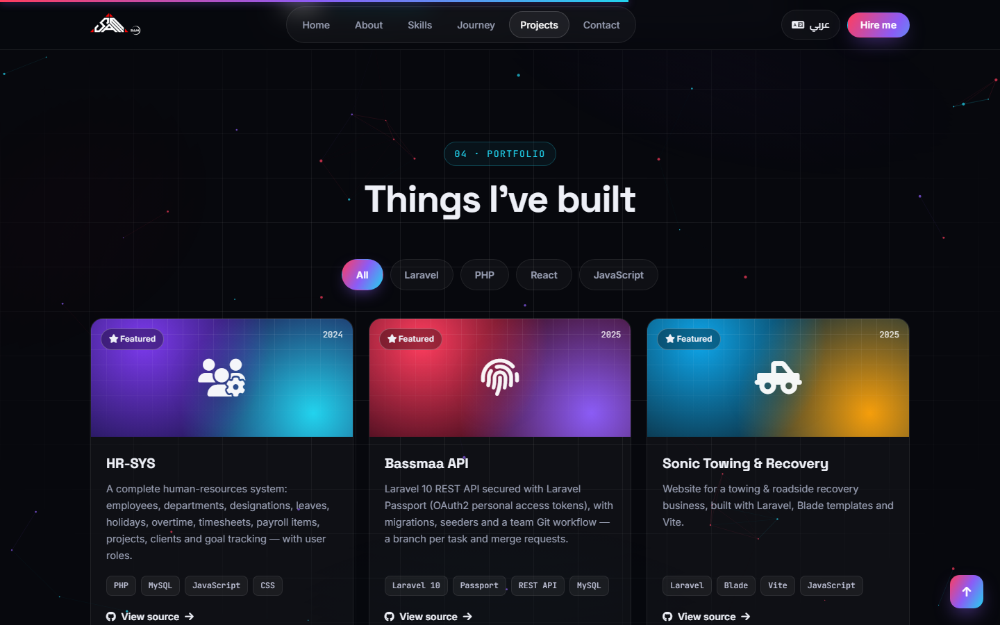

  

  
  
  
  
  

## 🌐 My Portfolio

<table>
  <tr>
    <td width="50%"></td>
    <td width="50%"></td>
  </tr>
  <tr>
    <td align="center">Full Arabic version (RTL) · النسخة العربية</td>
    <td align="center">Projects</td>
  </tr>
</table>

<a href="https://sami-al-njadat.github.io"><b>👉 Visit the live portfolio</b></a>

## 👨🏻‍💻 About Me

I'm **Sami Ismaeel Al-Najadat**, a passionate Full Stack Web Developer from Jordan with a backend heart. I work across two ecosystems — **PHP** (Laravel, Yii2) and **JavaScript / TypeScript** (Node.js, NestJS, React, Next.js) — on **MySQL** and **PostgreSQL**, picking the right tool for each project instead of forcing one stack.

I work as part of teams and have delivered many projects — for large companies and individual clients alike — across **healthcare, technology, finance, journalism, education, HR management** and more.

- 🏢 HR systems: attendance, shifts, calendars & payroll
- 🔐 Multi-company platforms with role-based access & custom permissions
- 🔌 REST APIs with Laravel, Node.js & NestJS — front ends with React & Next.js
- 🚀 Building and deploying full-stack projects in production (AWS, DigitalOcean, Vercel)

## 🛠️ Tech Stack

  
   
  

Also: Yii2 · Eloquent ORM · Laravel Passport · REST APIs · DigitalOcean · Database design

## 💼 Experience & Education

| | Role | Where |
|---|---|---|
| 🟢 **Now** | Freelance Full Stack Developer | Self-employed |
| ⏮️ Previously | Full Stack Web Developer | EMS |
| ⏮️ Previously | Web Developer | Releans |
| 💻 Bootcamp | Full Stack Web Development | Orange Coding Academy |
| 🎓 Degree | B.Sc. Finance & Banking Science | Yarmouk University |
| 🎓 Degree | B.Sc. Accounting | Yarmouk University |

## 🚀 Featured Projects

<table>
  <tr>
    <td width="50%" valign="top">

### [🧑‍💼 HR-SYS](https://github.com/Sami-AL-njadat/HR-SYS)
A complete human-resources system: employees, departments, leaves, holidays, overtime, timesheets, payroll items, projects and goal tracking — with user roles.

`PHP` `MySQL` `JavaScript`

  </td>
    <td width="50%" valign="top">

### [🔐 Bassmaa API](https://github.com/Sami-AL-njadat/Bassmaa)
Laravel 10 REST API secured with Laravel Passport (OAuth2), with migrations, seeders and a team Git workflow.

`Laravel 10` `Passport` `REST API` `MySQL`

  </td>
  </tr>
  <tr>
    <td valign="top">

### [🚛 Sonic Towing & Recovery](https://github.com/Sami-AL-njadat/Sonic-towing-Recovery)
Website for a towing & roadside recovery business, built with Laravel, Blade templates and Vite.

`Laravel` `Blade` `Vite`

  </td>
    <td valign="top">

### [🍦 SamIceCream](https://github.com/Sami-AL-njadat/samIceCream)
Ice-cream brand web app built with Laravel and Blade, styled with Tailwind CSS and bundled with Vite.

`Laravel` `Tailwind CSS` `Vite`

  </td>
  </tr>
  <tr>
    <td valign="top">

### [🛒 Full E-Commerce](https://github.com/Sami-AL-njadat/Full_ecommerce_php_mysql)
Authentication, product catalog, cart, checkout, order processing, reviews & ratings — planned as a team with Miro, Trello & DrawSQL.

`PHP` `MySQL` `JavaScript`

  </td>
    <td valign="top">

### [📊 React Dashboard](https://github.com/Sami-AL-njadat/Course-)
Front-end admin dashboard template built with React.js.

`React.js` `JavaScript` `CSS`

  </td>
  </tr>
</table>

<a href="https://sami-al-njadat.github.io/#projects">See all projects on my portfolio →</a>

## 📫 Let's Work Together

  Have a project or an opportunity? <a href="https://sami-al-njadat.github.io/#contact"><b>Send me a message</b></a> — it lands straight in my inbox.
   
  متاح للعمل الحر والمشاريع — تواصل معي عبر الموقع أو واتساب

